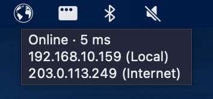

# Iniscape Ping

Tray app for Linux, macOS and Windows showing network connectivity status
and IP address.

## Install

**Linux and macOS**

    curl -fsSL https://github.com/iniscape/ping/releases/latest/download/install.sh | bash

**Windows (PowerShell)**

    irm https://github.com/iniscape/ping/releases/latest/download/install.ps1 | iex

Requirements: macOS 12 or later on Apple silicon, Linux x86_64 with glibc
2.28 or later (such as Ubuntu 20.04 or RHEL 8 and newer) or Windows 10 or 11 x64.

## Uninstall

**Linux and macOS**

    curl -fsSL https://github.com/iniscape/ping/releases/latest/download/uninstall.sh | bash

**Windows (PowerShell)**

    irm https://github.com/iniscape/ping/releases/latest/download/uninstall.ps1 | iex

## Notes

- **GNOME** shows tray icons only with the AppIndicator extension. Ubuntu
  has it on already; on Fedora and other GNOME desktops, install
  "AppIndicator and KStatusNotifierItem Support". GNOME shows no tooltip,
  so the status is the first line of the menu, which a click opens; a
  double-click copies the local IP address.
- **Windows 11 Smart App Control** may block a new release from starting,
  since the app is not code-signed yet, most often in the first hours
  after the release is out. The installer then stops with an error that
  says so; an update leaves the current version running. Try again later.
- **macOS 15 and later** may ask to let the app find devices on your local
  network. It uses this only to check that your router answers; saying no
  does not change the status.
- **macOS** shows "Background Items Added" after each update, since the
  app is not signed with an Apple Developer ID yet. That item is the
  app's start at login, which was already on; nothing needs doing.

## Privacy

No telemetry, no account, no tracking. Each check, every 30 seconds while
online (more often while not, and at once after a network change), makes:

- one small exchange with your router (the default gateway),
- one DNS lookup of `one.one.one.one` through your own DNS server,
- one TCP connection to `1.1.1.1` (Cloudflare) on port 443, and only if
  that fails, to `8.8.8.8` (Google).

For the latency, while online it also pings `1.1.1.1` every 5 seconds
(`8.8.8.8` on a network where `1.1.1.1` does not answer).

The internet IP address is obtained from `https://ipv4.icanhazip.com`
(Cloudflare), or `https://api.ipify.org` if that fails, when the network
changes and every 10 minutes while online. **Look Up Internet IP** in
Settings turns this off.

Once a day the app checks GitHub for a new release. It does not prompt
or download anything; the menu shows **Update Available**, and the update
downloads and installs only when you choose it there.

## Reporting a bug

Open an issue with the
[bug report form](https://github.com/iniscape/ping/issues/new/choose).
It asks for the version (shown in About), your OS and the log: About →
**Show Log** shows the file, or find it at:

- macOS: `~/Library/Logs/Iniscape/ping.log`
- Linux: `~/.local/state/iniscape/ping.log`
- Windows: `%LOCALAPPDATA%\Iniscape\ping.log`

Feature requests are welcome through the same page. They are read and
noted, then closed, as there is no public backlog. For security issues,
see [SECURITY.md](SECURITY.md).

## Changes

See [CHANGELOG.md](CHANGELOG.md).

## Licence

Copyright (c) 2026 Iniscape. All rights reserved. The Qt libraries that
come with the app are licensed under the LGPLv3; see the About dialog.
The licence texts come with the app.
