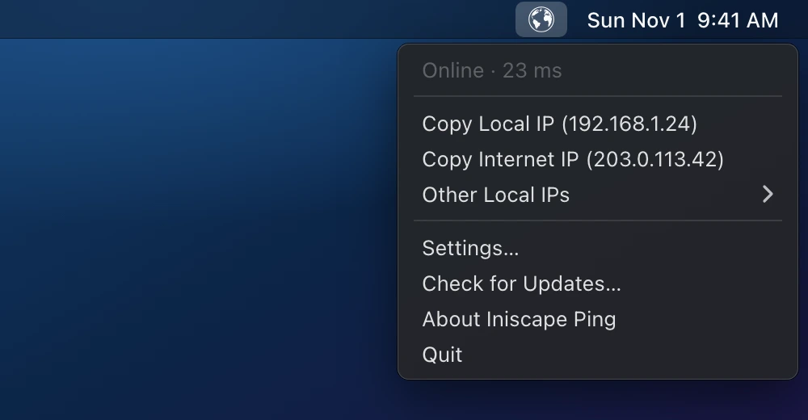
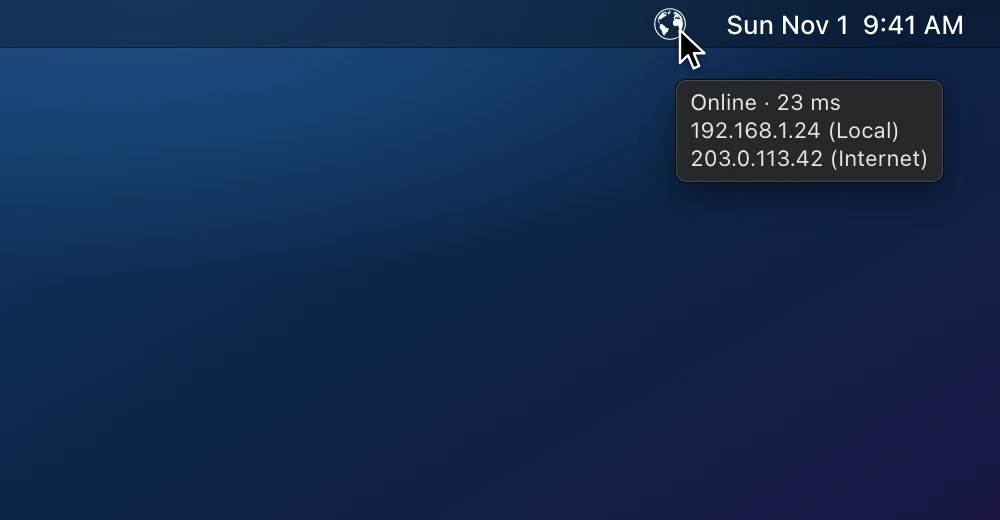

# Iniscape Ping

A tray app for macOS, Windows and Linux that shows whether you are
online: a network change appears within about 3 seconds, and a click
copies your local IP address.

Free, including for commercial use. More info at
[iniscape.com/ping](https://iniscape.com/ping).

## What it does

- **Four connection states.** Online, Unstable, Limited or Offline, shown
  by the globe in the tray.
- **Where it breaks.** The first step that fails: link, address, gateway,
  DNS or internet.
- **Changes in about 3 seconds.** After a network change or sleep; one
  lost probe never changes the state.
- **Local and internet IP.** In the tooltip and the menu; a click copies
  your local address.
- **Latency and packet loss.** The median round trip and the probes lost
  over the last 5 minutes.
- **Light on the network.** About 4.5 MB a day while online, checks and
  latency probes together.

## Install

**macOS and Linux**

    curl -fsSL https://github.com/iniscape/ping/releases/latest/download/install.sh | bash

**Windows (PowerShell)**

    powershell -ExecutionPolicy Bypass -c 'irm https://github.com/iniscape/ping/releases/latest/download/install.ps1 -OutFile $env:TEMP\install.ps1; & $env:TEMP\install.ps1'

Requirements: macOS 12+ on Apple silicon, Windows 10+ on x64 or
Linux (glibc 2.28+) on x86_64.

It installs for the current user, without admin rights: in
`~/Applications` on macOS, `%LOCALAPPDATA%\Programs` on Windows and
`~/.local` on Linux.

## Uninstall

Uninstall from the app, Settings → *Uninstall Iniscape Ping…*, or with
the commands below. Uninstalling removes the app, its start at login, and
its settings and log.

**macOS and Linux**

    curl -fsSL https://github.com/iniscape/ping/releases/latest/download/uninstall.sh | bash

**Windows**: Settings → Apps → Installed apps → Iniscape Ping →
Uninstall, or in PowerShell

    powershell -ExecutionPolicy Bypass -c 'irm https://github.com/iniscape/ping/releases/latest/download/uninstall.ps1 -OutFile $env:TEMP\uninstall.ps1; & $env:TEMP\uninstall.ps1'

## Notes

- **macOS 15 and later** may ask to let the app find devices on your local
  network. It uses this only to check that your router answers; saying no
  does not change the status.
- **macOS** shows "Background Items Added" after each update, since the
  app is not signed with an Apple Developer ID yet. That item is the
  app's start at login, which was already on; nothing needs doing.
- **Windows 11 Smart App Control** may block a new release from starting,
  since the app is not code-signed yet, most often in the first hours
  after the release is out. The installer then stops with an error that
  says so; an update leaves the current version running. Try again later.
- **GNOME** shows tray icons only with the AppIndicator extension. Ubuntu
  has it on already; on Fedora and other GNOME desktops, install
  "AppIndicator and KStatusNotifierItem Support". GNOME shows no tooltip,
  so the status is the first line of the menu, which a click opens; a
  double-click copies the local IP address.

## Privacy

Iniscape Ping does not collect, share or sell any personal data. There is
no account, and no built-in analytics, telemetry, crash reporting or
advertising of any kind.

To show whether you are online and its latency, the app checks that your
router and your DNS server respond, and that it can reach well-known
public servers from Cloudflare and Google. With *Look Up Internet IP*
enabled in Settings, the app gets your internet IP address from a public
service by Cloudflare, or from ipify if that is unavailable. With *Check
for Updates Automatically* enabled in Settings, it checks GitHub, where
its releases are published, once a day for a new version.

Everything else the app keeps, its settings and its log, stays on your
computer, and uninstalling removes it.

## Reporting a bug

Open an issue with the
[bug report form](https://github.com/iniscape/ping/issues/new/choose).
It asks for the version (shown in About), your OS and the log: About →
*Show Log* shows the file, or find it at:

- macOS: `~/Library/Logs/Iniscape/Ping/ping.log`
- Windows: `%LOCALAPPDATA%\Iniscape\Ping\ping.log`
- Linux: `~/.local/state/iniscape-ping/ping.log`

Feature requests are welcome through the same page. They are read and
noted, then closed, as there is no public backlog. For security issues,
see [SECURITY.md](SECURITY.md).

## Changes

See [CHANGELOG.md](CHANGELOG.md).

## Licence

Copyright (c) 2026 Iniscape. All rights reserved. The Qt libraries that
come with the app are licensed under the LGPLv3; see *Licenses* in the
About dialog, which also lists the other third-party code. The licence
texts come with the app.
